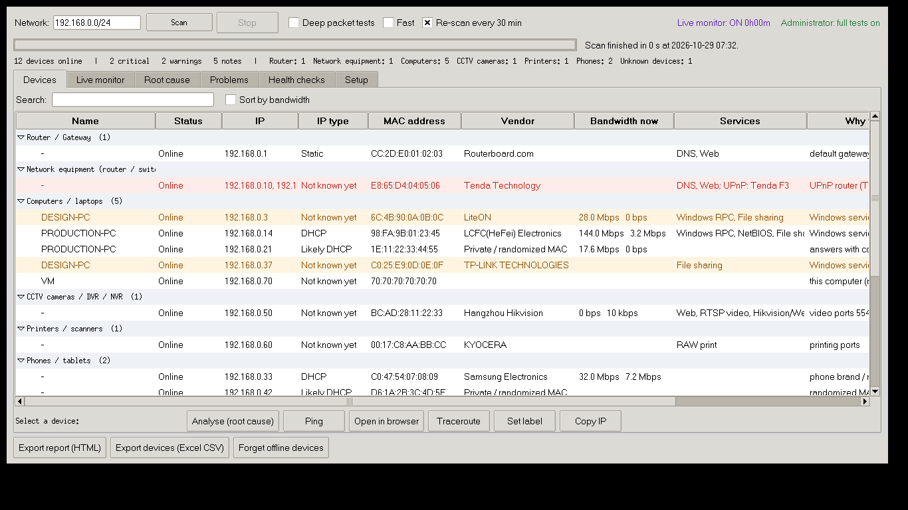
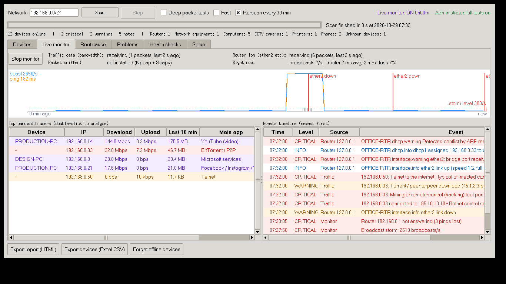
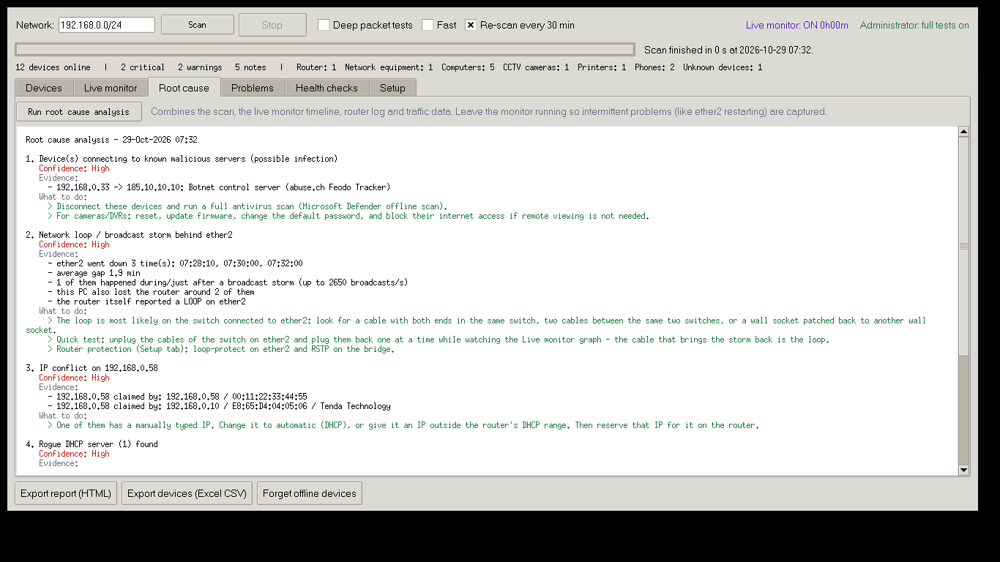
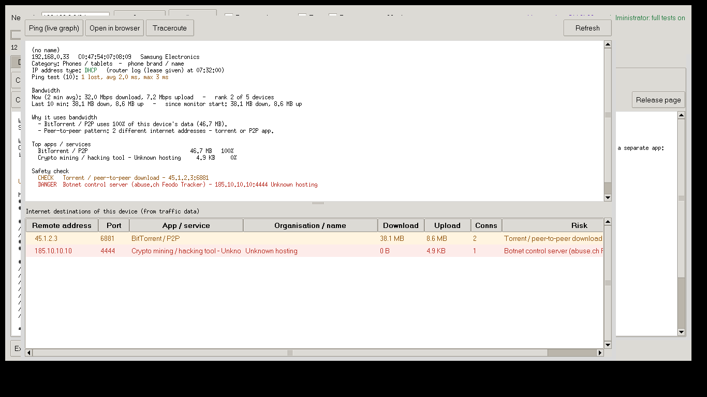

# Network Doctor

A standalone network scanner, live monitor and root-cause tool for office LANs. It finds every device, sorts each one into a category, and tells you **why** the network misbehaves: IP conflicts, loops, ports dropping, rogue DHCP servers, the device using all the bandwidth, and devices talking to dangerous servers.



| Platform | Status |
|---|---|
| Windows | **Available** - [download the latest NetworkDoctor.exe](https://github.com/yadavrkpacheriya/network-doctor/releases/latest) |
| Android | in development |
| macOS | planned |
| iPhone / iPad | planned |

## Install (Windows)

1. Download **NetworkDoctor.exe** from the [latest release](https://github.com/yadavrkpacheriya/network-doctor/releases/latest).
2. Put it in any folder, for example `C:\NetworkDoctor`, and double-click it.
   - If Windows says *"Windows protected your PC"*, click **More info → Run anyway**. This appears because the app is not code-signed.
   - The app asks for Administrator permission. It needs this for the full IP-conflict and loop tests.
3. You don't need to install anything else. Python is **not** needed.

**Updates are automatic.** Once a day the app checks this repository for a new release. When one is out, it asks you, downloads it, verifies the SHA-256 checksum, and restarts. You can also use **Setup → Check for updates**.

## What it does

| Tab | Shows |
|---|---|
| **Devices** | Every device, grouped: router, network equipment, computers, CCTV, printers, biometric, phones, smart TV / IoT, unknown, and devices not online now. For each one it shows the IP type (DHCP / static / fixed, with the evidence), live bandwidth, and why it got its category. Buttons: Analyse, Ping (live graph), Open in browser, Traceroute, Set label. |
| **Live monitor** | Runs continuously. A 10-minute graph of broadcasts per second and router ping, with markers when a port goes down. Also the top bandwidth users and a timeline of events. |
| **Root cause** | Ranked causes, each with confidence, evidence and what to do. For example: *loop behind ether2*, *ether2 flapping with no loop → cable or switch power*, *device X uses 70% of the internet*, *device talking to a botnet server*, *DVR reachable from the internet*, *IP conflict*, *rogue DHCP*, *password guessing on the router*. |
| **Problems / Health checks** | Results of the scan. |
| **Setup** | One-time router settings, Windows Firewall, threat lists and updates. |




**Device analysis** shows, for one device:
- its bandwidth now and over the last 10 minutes
- why it uses bandwidth (video streaming, Windows Update, torrent, cloud backup, remote viewing)
- the apps and services behind its traffic
- every internet destination, with the organisation behind it

Each destination is checked against public malware, botnet and attacker block lists. It also flags Tor, VPNs, crypto mining, Telnet malware patterns and ports exposed to the internet.



## One-time router setting (optional, recommended)

On a switched network, a PC can't see other devices' traffic or the router's ports. Two features therefore need the router to **send** standard data to the PC running Network Doctor:
- **bandwidth per device**, using NetFlow on UDP 2055
- **port up/down and DHCP events**, using syslog on UDP 514

The app never logs in to the router. The exact MikroTik commands, with your PC's IP already filled in, are in **Setup → Copy router commands**. Any router or managed switch that can export NetFlow, IPFIX or syslog works.

Optional: install [Npcap](https://npcap.com) to turn on the packet sniffer. It adds:
- the loop echo test
- a list of which devices send the broadcasts
- NetCut / ARP-spoofing detection

## Phone app link

In **Setup → Phone app link**, tick *Allow the Network Doctor phone app to connect*. The phone app then finds the PC on the office Wi-Fi by itself. You enter the 6-digit code shown on the PC once, and the phone can then show the PC's devices, problems, root cause, live monitor and top bandwidth users.

- It works on the local network only (TCP 8787, discovery on UDP 8788).
- Requests from internet addresses are refused.
- Each pairing code works once.

## Privacy

Network Doctor runs entirely on your PC.

**What it keeps:**
- Device names, labels and history stay in `%APPDATA%\NetworkDoctor`.

**What it sends over the internet:**
- To GitHub: a request for the latest release.
- To public blocklist sites: requests to download the blocklists.
- To RDAP registries (`rdap.org`): addresses of *internet* servers your devices talk to, to look up which organisation owns them.

Nothing about your own network is uploaded.

## For maintainers: publishing a new version

1. Change the code in `desktop/`.
2. Raise `VERSION = "x.y.z"` near the top of `desktop/NetworkDoctor.py`, and update `desktop/RELEASE_NOTES.md`.
3. Push to `main`. You can also edit the files directly on github.com and commit.

The **Desktop - build and release** workflow (see the Actions tab) builds `NetworkDoctor.exe` on a free Windows machine and publishes the Release with its checksum. Every installed copy then offers the update within a day.

To build locally instead, run `desktop/Build_NetworkDoctor_EXE.bat` on a Windows PC with Python installed.

## Repository layout

```
desktop/   Windows (later also macOS) app - Python + Tkinter
  NetworkDoctor.py   window
  nd_core.py         scan engine
  nd_monitor.py      live monitor, traffic, threat lists, root cause
  nd_update.py       online updates from GitHub Releases
  nd_share.py        phone app link (LAN only, pairing code)
mobile/    Android / iPhone app (coming)
docs/      screenshots
```
