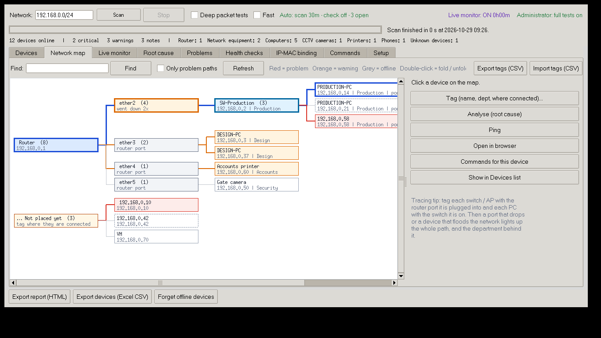
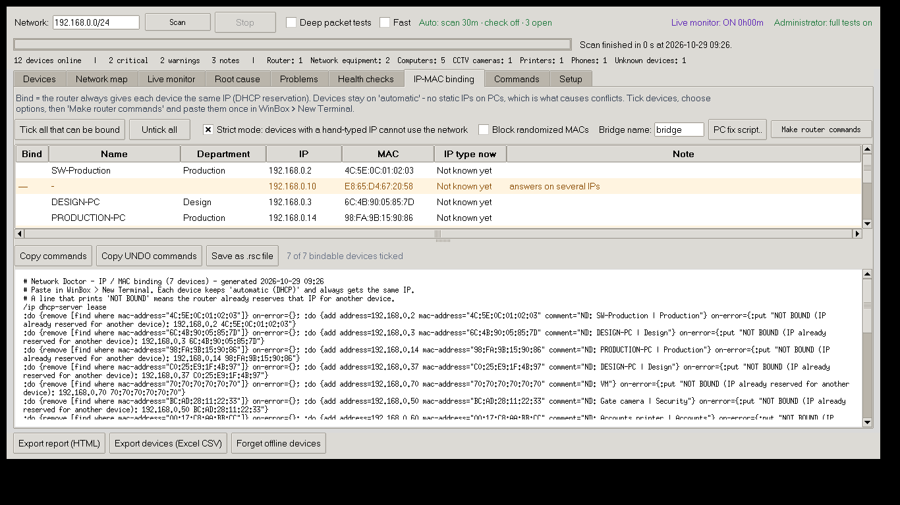
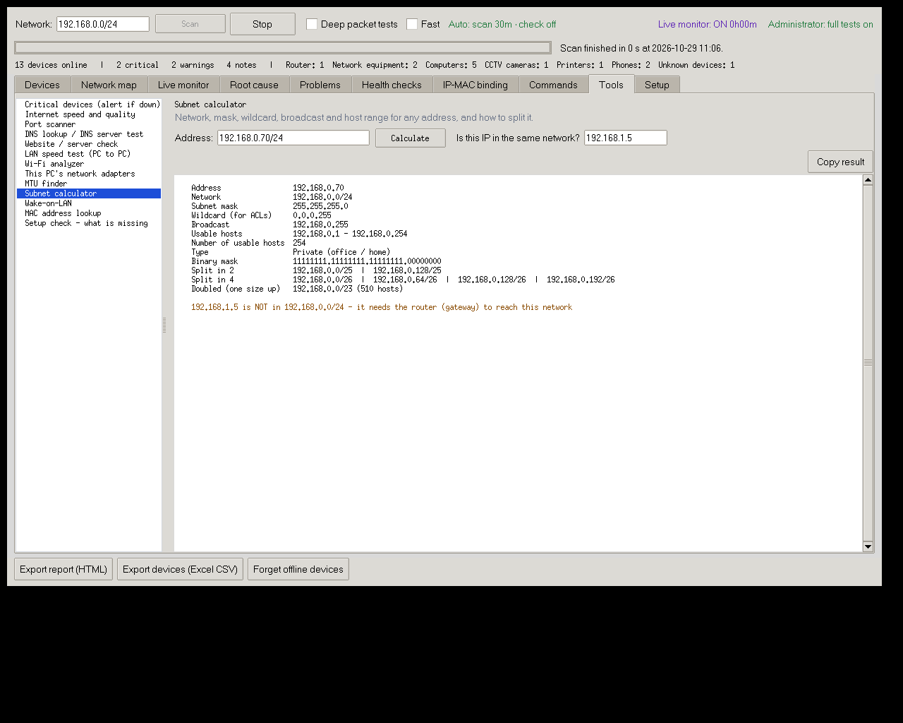

# Network Doctor

A standalone network scanner, live monitor and root-cause tool for office LANs. It finds every device, sorts each one into a category, and tells you **why** the network misbehaves: IP conflicts, loops, ports dropping, rogue DHCP servers, the device using all the bandwidth, and devices talking to dangerous servers.


| Platform | Status | Get it |
|---|---|---|
| Windows | **Available** - full features | `NetworkDoctor.exe` from the [latest release](https://github.com/yadavrkpacheriya/network-doctor/releases/latest) |
| macOS (Apple silicon) | **Available** - full features (IP-conflict rounds need admin) | `NetworkDoctor-macOS.zip` from the [latest release](https://github.com/yadavrkpacheriya/network-doctor/releases/latest) |
| Linux (x86-64) | **From the next release** - full features (run with `sudo` for the IP-conflict rounds) | `NetworkDoctor-Linux` from the [latest release](https://github.com/yadavrkpacheriya/network-doctor/releases/latest) |
| Android | **Test version** - phone scan + office PC link | `NetworkDoctor-Android.apk` from the [Android releases](https://github.com/yadavrkpacheriya/network-doctor/releases?q=mobile&expanded=true); Google Play coming |
| Google Play, Microsoft Store, signed Mac | waiting for developer accounts | see [docs/STORES.md](docs/STORES.md) |

## Install (Windows)

1. Download **NetworkDoctor.exe** from the [latest release](https://github.com/yadavrkpacheriya/network-doctor/releases/latest).
2. Put it in any folder, for example `C:\NetworkDoctor`, and double-click it.
   - If Windows says *"Windows protected your PC"*, click **More info → Run anyway**. This appears because the app is not code-signed.
   - The app asks for Administrator permission. It needs this for the full IP-conflict and loop tests.
3. You don't need to install anything else. Python is **not** needed.

## Install (Mac)

1. Download **NetworkDoctor-macOS.zip** from the [latest release](https://github.com/yadavrkpacheriya/network-doctor/releases/latest), unzip it and move **NetworkDoctor** to *Applications*.
2. The first time, **right-click → Open**. If macOS still blocks it, go to **System Settings → Privacy & Security → Open Anyway** (the app is not yet signed with an Apple Developer certificate).
3. On the Mac the router log arrives on UDP **5514** (macOS reserves ports below 1024); *Setup → Copy router commands* already uses it.

## Install (Linux)

1. Download **NetworkDoctor-Linux** from the [latest release](https://github.com/yadavrkpacheriya/network-doctor/releases/latest) into a folder you own, for example `~/NetworkDoctor`.
2. Make it runnable once: `chmod +x NetworkDoctor-Linux`, then start it: `./NetworkDoctor-Linux`.
3. Updates are automatic, as on Windows and Mac. Keep the file in a folder you can write to so the updater can replace it.

## Install (Android phone)

Open the [Android release](https://github.com/yadavrkpacheriya/network-doctor/releases?q=mobile&expanded=true) on the phone, download **NetworkDoctor-Android.apk** and allow *Install unknown apps* for the browser when Android asks. The app scans the Wi-Fi network by itself and, once paired, shows everything the office PC finds. Android does not let apps read other devices' MAC addresses, so vendor names and IP-conflict detection come from the PC.

**Updates are automatic** on Windows and Mac. Once a day the app checks this repository for a new release. When one is out, it asks you, downloads it, verifies the SHA-256 checksum, and restarts. You can also use **Setup → Check for updates**.

## What it does

| Tab | Shows |
|---|---|
| **Devices** | Every device, grouped: router, network equipment, computers, CCTV, printers, biometric, phones, smart TV / IoT, unknown, and devices not online now. For each one it shows the IP type (DHCP / static / fixed, with the evidence), live bandwidth, and why it got its category. Buttons: Analyse, Ping (live graph), Open in browser, Traceroute, Tag (name, department, where connected; several devices at once), Show on map, Commands. |
| **Network map** | Router → ports → switches / APs → devices, from your tags and from MikroTik switches that announce themselves. Problem devices and their path to the router are shown in red / orange, so you can trace a loop or flood to a port, switch and department. Tags export to / import from Excel. |
| **Automatic checks (24/7)** | A loop / IP-conflict / rogue-DHCP / stability check every 5 minutes and a full scan every 30 minutes (both adjustable). A pop-up and sound when a new problem appears, a "Resolved" note when it goes away, and a monthly health log in Excel format. It can start with Windows (or at Mac login), minimised. |
| **Live monitor** | Runs continuously. A 10-minute graph of broadcasts per second and router ping, with markers when a port goes down. Also the top bandwidth users and a timeline of events. |
| **Root cause** | Ranked causes, each with confidence, evidence and what to do. For example: *loop behind ether2*, *ether2 flapping with no loop → cable or switch power*, *device X uses 70% of the internet*, *device talking to a botnet server*, *DVR reachable from the internet*, *IP conflict*, *rogue DHCP*, *password guessing on the router*. |
| **Problems / Health checks** | Results of the scan. |
| **IP-MAC binding** | Makes the MikroTik commands that reserve each device's IP for its MAC (with optional strict mode and randomized-MAC blocking, and an UNDO set). Also makes the **PC fix script** to run on every PC: random Wi-Fi MAC off, back to automatic IP, router MAC lock, and a report back that tags the PC. |
| **Commands** | About 40 ready Windows, MikroTik and Mac commands with a short line on what each does, filled in for the chosen device. Copy or run, and add your own. |
| **Tools** | Critical-device watch (alert when the router, server, ERP PC, DVR or a switch stops answering), switch / router details over SNMP for any brand (ports, speed, errors, LLDP neighbours, which device is on which port), internet speed and quality, port scanner, DNS lookup and DNS server test, website / server check, LAN speed test between two PCs, Wi-Fi analyzer, this PC's adapters (cable speed, duplex, errors), MTU finder, subnet calculator, Wake-on-LAN, MAC lookup, and a setup check that lists what is still missing. |
| **Setup** | One-time router settings, Windows Firewall, threat lists and updates. |






**Device analysis** shows, for one device:
- its bandwidth now and over the last 10 minutes
- why it uses bandwidth (video streaming, Windows Update, torrent, cloud backup, remote viewing)
- the apps and services behind its traffic
- every internet destination, with the organisation behind it

Each destination is checked against public malware, botnet and attacker block lists. It also flags Tor, VPNs, crypto mining, Telnet malware patterns and ports exposed to the internet.


## One-time router setting (optional, recommended)

On a switched network, a PC can't see other devices' traffic or the router's ports. Two features therefore need the router to **send** standard data to the PC running Network Doctor:
- **bandwidth per device**, using NetFlow on UDP 2055
- **port up/down and DHCP events**, using syslog on UDP 514 (Windows) or 5514 (Mac)

The app never logs in to the router. The exact MikroTik commands, with your PC's IP already filled in, are in **Setup → Copy router commands**. Any router or managed switch that can export NetFlow, IPFIX or syslog works.

Optional: install [Npcap](https://npcap.com) to turn on the packet sniffer. It adds:
- the loop echo test
- a list of which devices send the broadcasts
- NetCut / ARP-spoofing detection

## Phone app link

In **Setup → Phone app link**, tick *Allow the Network Doctor phone app to connect*. The phone app then finds the PC on the office Wi-Fi by itself. You enter the 6-digit code shown on the PC once, and the phone can then show the PC's devices, problems, root cause, live monitor and top bandwidth users.

- It works on the local network only (TCP 8787, discovery on UDP 8788).
- Requests from internet addresses are refused.
- Each pairing code works once.

## Privacy

Full policy: [PRIVACY.md](PRIVACY.md).

Network Doctor runs entirely on your PC.

**What it keeps:**
- Device names, labels and history stay in `%APPDATA%\NetworkDoctor` (Windows) or `~/Library/Application Support/NetworkDoctor` (Mac).

**What it sends over the internet:**
- To GitHub: a request for the latest release.
- To Cloudflare (`speed.cloudflare.com`), only when you run the internet speed test: test data.
- To public blocklist sites: requests to download the blocklists.
- To RDAP registries (`rdap.org`): addresses of *internet* servers your devices talk to, to look up which organisation owns them.

Nothing about your own network is uploaded.

## For maintainers: publishing a new version

1. Change the code in `desktop/`.
2. Raise `VERSION = "x.y.z"` near the top of `desktop/NetworkDoctor.py`, and update `desktop/RELEASE_NOTES.md`.
3. Push to `main`. You can also edit the files directly on github.com and commit.

The **Desktop - build and release** workflow (see the Actions tab) builds `NetworkDoctor.exe` on a free Windows machine and the Mac app on a free Mac machine, and publishes both in one Release with checksums. Every installed copy then offers the update within a day.

**Phone app:** change the code in `mobile/`, raise `version:` in `mobile/pubspec.yaml` (and `appVersion` in `mobile/lib/main.dart`), push. The **Mobile - build Android app** workflow checks the code, runs the tests and publishes a new APK. Once the Google Play upload-key secrets are added, it also builds the signed `.aab` for the Play Store.

To build locally instead, run `desktop/Build_NetworkDoctor_EXE.bat` on a Windows PC with Python installed.

## Repository layout

```
desktop/   Windows, macOS and Linux app - Python + Tkinter
  NetworkDoctor.py   window
  nd_core.py         scan engine
  nd_monitor.py      live monitor, traffic, threat lists, root cause
  nd_update.py       online updates from GitHub Releases
  nd_share.py        phone app link (LAN only, pairing code) and PC fix-script reports
  nd_tools.py        tags, map, IP-MAC binding, PC fix script, command list
  nd_tabs.py         Network map, IP-MAC binding and Commands tabs
  nd_net.py          engineer tools: port scan, DNS, speed tests, Wi-Fi, adapters, MTU, subnet, Wake-on-LAN
  nd_toolstab.py     Tools tab (including the critical-device watch)
  nd_plugins.py      device plugins: one per protocol or brand, same shape for all
  nd_linux.py        Linux network facts from /proc and /sys (no extra tools needed)
  nd_snmp.py         SNMP reader (v1 / v2c, read-only) for switches and routers of any brand
  tests/             tests (python -m unittest discover -s tests, from desktop/)
mobile/    Android phone app - Flutter (iPhone possible later from the same code)
docs/      screenshots
```
